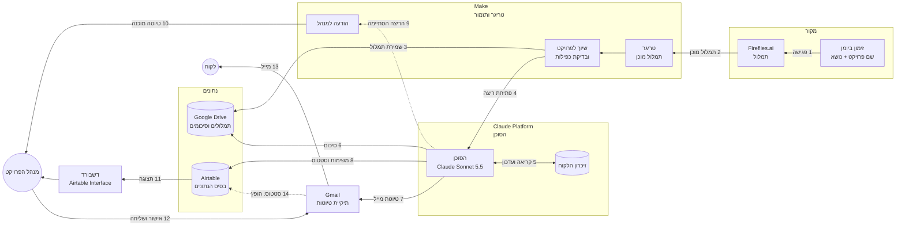
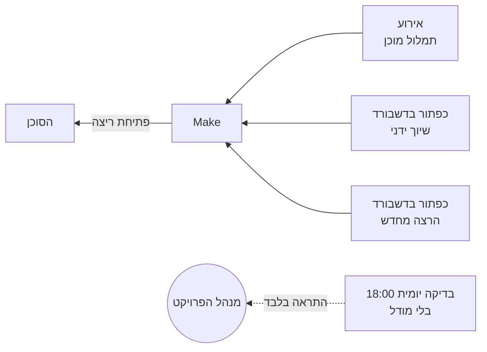
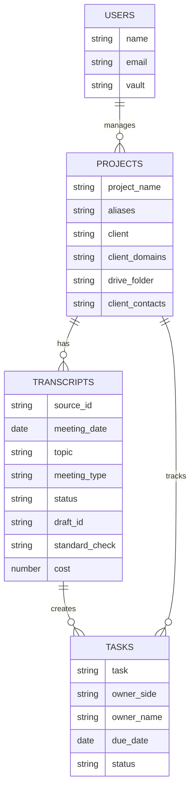

# ארכיטקטורה: סוכן סיכומי פגישות

המסמך עונה על שלוש שאלות: **מה מפעיל את הסוכן**, **מה עושים עם הפלט שלו**, ו**איך המידע זורם** בין רכיבי המערכת. הפירוט המלא נמצא ב-[SPEC.md](SPEC.md).

**החלוקה בין הפלטפורמות:**
- **Make** אחראי על הטריגרים והתזמור.
- **Claude Platform (Anthropic)** מריץ את הסוכן עצמו.

---

## 1. תרשים המערכת וזרימת המידע

| # | מאיפה | לאן | מה עובר |
|---|---|---|---|
| 1 | יומן מנהל הפרויקט | Fireflies | Fireflies מצטרף לפגישה ומתמלל אותה |
| 2 | Fireflies | Make | **הטריגר:** אירוע "תמלול מוכן", עם מזהה הפגישה |
| 3 | Make | Drive | קובץ התמלול, בתיקיית הפרויקט |
| 4 | Make | הסוכן | פתיחת ריצה: פרטי הפגישה, ההרשאות של המנהל וזיכרון הלקוח |
| 5 | זיכרון הלקוח | הסוכן | נושאים פתוחים ופרופיל הלקוח. בסוף הריצה הסוכן מעדכן אותם |
| 6 | הסוכן | Drive | קובץ הסיכום |
| 7 | הסוכן | Gmail | טיוטת מייל ללקוח, בתיקיית הטיוטות |
| 8 | הסוכן | Airtable | סטטוס, בדיקת איכות, משימות ועלות |
| 9 | Claude Platform | Make | הודעה שהריצה הסתיימה |
| 10 | Make | מנהל הפרויקט | "הטיוטה מוכנה", עם קישור ודגלים לבירור |
| 11 | Airtable | הדשבורד | כל הנתונים, מסוננים לפי מנהל הפרויקט |
| 12 | מנהל הפרויקט | Gmail | בדיקה, תיקון ושליחה |
| 13 | Gmail | לקוח | מייל הסיכום |
| 14 | Gmail (דרך Make) | Airtable | סטטוס "הופץ", ולמידה מהתיקונים |

---

## 2. הטריגר: מה גורם לסוכן לרוץ

**הטריגר הראשי הוא אירוע, לא לוח זמנים.** הסוכן רץ פעם אחת בדיוק לכל תמלול חדש. כשאין פגישות, אין ריצות ואין עלות.

| טריגר | מתי | מה קורה |
|---|---|---|
| **תמלול מוכן** (ראשי) | Fireflies סיים לתמלל פגישה | Make משייך לפרויקט, שומר ופותח ריצה לסוכן |
| **שיוך ידני** | מנהל בחר פרויקט לתמלול שלא שויך | Make ממשיך מאותה נקודה ופותח ריצה |
| **הרצה מחדש** | מנהל לחץ "הרץ שוב" על תמלול בשגיאה | ריצה חדשה, עם אותו תקציב |
| **בדיקה יומית** | כל יום ב-18:00 | **לא מפעילה את הסוכן.** רק מתריעה על תמלולים שנתקעו |

---

## 3. הפלט: מה עושים איתו

| פלט הסוכן | לאן נשמר | מי משתמש בו | מה קורה איתו |
|---|---|---|---|
| **טיוטת מייל ללקוח** | Gmail, תיקיית הטיוטות | מנהל הפרויקט | בודק, מתקן ושולח ללקוח. בהמשך: שליחה אוטומטית בתנאים |
| **קובץ סיכום** | Drive, `/<פרויקט>/סיכומים/` | מנהל הפרויקט, הלקוח | ארכיון לפי פרויקט |
| **משימות** (משימה, אחראי, תאריך יעד) | Airtable | הדשבורד, הסוכן בפגישה הבאה | מעקב משימות פתוחות לפי פרויקט ואחראי |
| **סטטוס, בדיקת איכות, דגלים** | Airtable | הדשבורד, ההודעה למנהל | מה צריך לבדוק לפני שליחה |
| **עלות הריצה** | Airtable | הדשבורד | מעקב מול התקרה ($0.50 לתמלול) |
| **עדכון זיכרון** (נושאים פתוחים, לקחים) | זיכרון הלקוח, Claude Platform | הסוכן בריצה הבאה | מעקב מהפגישה הקודמת |
| **יומן הריצה** | Session viewer, Claude Platform | מי שמתחזק את הסוכן | איתור תקלות ובדיקת עלות |

---

## 4. בסיס הנתונים (Airtable)

| טבלה | מה יש בה |
|---|---|
| **Users** | מנהלי הפרויקטים. לכל אחד יש כספת (Vault) משלו ב-Claude Platform |
| **Projects** | פרויקטים: שם, כינויים, לקוח, דומיינים, תיקייה ב-Drive, אנשי קשר |
| **Transcripts** | תמלול אחד לכל פגישה: סטטוס, קישור לטיוטה, בדיקת איכות ועלות |
| **Tasks** | המשימות שנולדו בפגישות, עם אחראי, תאריך יעד וסטטוס |

**סטטוסים של תמלול:** ממתין לשיוך ← בעיבוד ← ממתין לאישור / נדרש בירור / שגיאה ← הופץ

---

## 5. הדשבורד

**Airtable Interface**, עם הרשאות לפי משתמש. כל מנהל פרויקט רואה רק את הפרויקטים שלו.

| עמוד | מה רואים | מה אפשר לעשות |
|---|---|---|
| **ממתין לאישור** | טיוטות שמחכות לשליחה, עם דגלים | לפתוח את הטיוטה ב-Gmail |
| **ממתין לשיוך** | תמלולים שלא זוהה להם פרויקט | לבחור פרויקט (טריגר לשיוך ידני) |
| **משימות פתוחות** | משימות לפי פרויקט, אחראי ותאריך, ומשימות באיחור | לעדכן סטטוס |
| **סיכונים** | סיכוני לו"ז, תכולה ותקציב מהפגישות האחרונות | – |
| **עלות ותפעול** | עלות חודשית, עלות ממוצעת לתמלול, ריצות שנכשלו | להריץ שוב (טריגר) |

---

## 6. מה רץ איפה

| | **Make** | **Claude Platform (Anthropic)** |
|---|---|---|
| **תפקיד** | הטריגר והצנרת | הסוכן: קריאה, שיפוט, סיכום, ניסוח |
| **מופעל על ידי** | Fireflies, כפתורים בדשבורד, השעון (בדיקה יומית) | Make, דרך ה-API |
| **משתמש במודל?** | רק לשיוך פרויקט במקרה קשה (Claude Haiku) | כן, Claude Sonnet 5.5 |
| **כותב אל** | Drive (תמלולים), Airtable, הודעות למנהל | Drive (סיכומים), Gmail (טיוטות), Airtable, זיכרון |
| **אסור לו** | לשלוח מייל ללקוח (עד שלב השליחה האוטומטית) | לשלוח, למחוק, להזיז קבצים |

