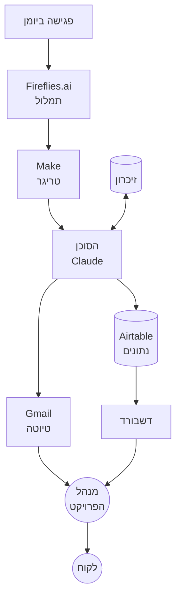
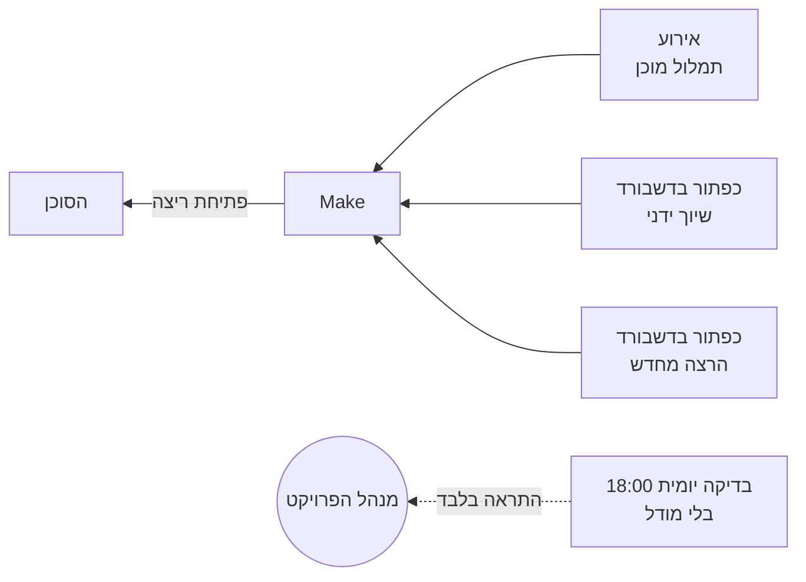
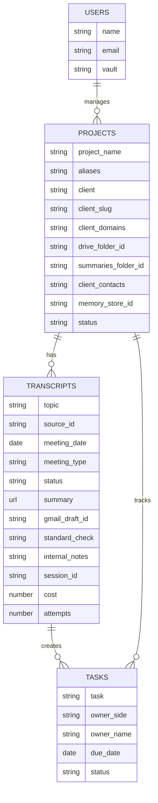

# ארכיטקטורה: סוכן סיכומי פגישות

המסמך עונה על שלוש שאלות: **מה מפעיל את הסוכן**, **מה עושים עם הפלט שלו**, ו**איך המידע זורם** בין רכיבי המערכת. הפירוט המלא נמצא ב-[SPEC.md](SPEC.md).

**החלוקה בין הפלטפורמות:**
- **Make** אחראי על הטריגרים והתזמור.
- **Claude Platform (Anthropic)** מריץ את הסוכן עצמו.

| גרסה | תאריך | מה השתנה | קובץ |
|---|---|---|---|
| **1.1** | 27.11.2026 | תרשים בסיס הנתונים לפי הבסיס שנבנה, סימון מה נבנה ומה מתוכנן (סעיפים 4, 5, 7), טריגר ידני לריצת הניסיון (סעיף 2) וקישור ל-SPEC 1.1 | הקובץ הזה |
| 1.0 | 26.11.2026 | תכנון ראשוני | [versions/Architecture-v1.0.md](versions/Architecture-v1.0.md) |

**מצב:** המסמך מתאר את הארכיטקטורה המתוכננת. מה שנבנה עד כה מסומן בסעיף 7. ה-SPEC הנוכחי הוא [גרסה 1.1](SPEC.md).

---

## 1. תרשים המערכת וזרימת המידע

| # | שלב | מאיפה ← לאן |
|---|---|---|
| 1 | Fireflies מתמלל את הפגישה | יומן ← Fireflies |
| 2 | **הטריגר:** "תמלול מוכן" | Fireflies ← Make |
| 3 | Make מפעיל את הסוכן | Make ← הסוכן |
| 4 | הסוכן קורא ומעדכן את זיכרון הלקוח | זיכרון ↔ הסוכן |
| 5 | סיכום, משימות וסטטוס | הסוכן ← Airtable (ו-Drive) |
| 6 | טיוטת מייל ללקוח | הסוכן ← Gmail |
| 7 | מנהל הפרויקט רואה ובודק | Airtable ← דשבורד ← מנהל הפרויקט |
| 8 | מנהל הפרויקט מאשר ושולח | Gmail ← לקוח |

---

## 2. הטריגר: מה גורם לסוכן לרוץ

**הטריגר הראשי הוא אירוע, לא לוח זמנים.** הסוכן רץ פעם אחת בדיוק לכל תמלול חדש. כשאין פגישות, אין ריצות ואין עלות.

| טריגר | מתי | מה קורה |
|---|---|---|
| **תמלול מוכן** (ראשי) | Fireflies סיים לתמלל פגישה | Make משייך לפרויקט, שומר ופותח ריצה לסוכן |
| **שיוך ידני** | מנהל בחר פרויקט לתמלול שלא שויך | Make ממשיך מאותה נקודה ופותח ריצה |
| **הרצה מחדש** | מנהל לחץ "הרץ שוב" על תמלול בשגיאה | ריצה חדשה, עם אותו תקציב |
| **בדיקה יומית** | כל יום ב-18:00 | **לא מפעילה את הסוכן.** רק מתריעה על תמלולים שנתקעו |

**בריצת הניסיון החד-פעמית (27.11.2026):** Make לא פעיל. את מקומו של הטריגר תופסת **הודעה ראשונה שנשלחת ידנית לסשן ב-Claude Console**, עם אותם שדות ש-Make אמור להעביר (מזהה בסיס, טבלאות, רשומת תמלול, קובץ תמלול ופרטי הפגישה). זו הדרך לבדוק את הסוכן לפני שמחברים את ה-Make.

---

## 3. הפלט: מה עושים איתו

| פלט הסוכן | לאן נשמר | מי משתמש בו | מה קורה איתו |
|---|---|---|---|
| **טיוטת מייל ללקוח** | Gmail, תיקיית הטיוטות | מנהל הפרויקט | בודק, מתקן ושולח ללקוח. בהמשך: שליחה אוטומטית בתנאים |
| **קובץ סיכום** | Drive, `/<פרויקט>/סיכומים/` | מנהל הפרויקט, הלקוח | ארכיון לפי פרויקט |
| **משימות** (משימה, אחראי, תאריך יעד) | Airtable | הדשבורד, הסוכן בפגישה הבאה | מעקב משימות פתוחות לפי פרויקט ואחראי |
| **סטטוס, בדיקת איכות, דגלים** | Airtable | הדשבורד, ההודעה למנהל | מה צריך לבדוק לפני שליחה |
| **עלות הריצה** | Airtable | הדשבורד | מעקב מול התקרה ($0.50 לתמלול) |
| **עדכון זיכרון** (נושאים פתוחים, לקחים) | זיכרון הלקוח, Claude Platform | הסוכן בריצה הבאה | מעקב מהפגישה הקודמת |
| **יומן הריצה** | Session viewer, Claude Platform | מי שמתחזק את הסוכן | איתור תקלות ובדיקת עלות |

---

## 4. בסיס הנתונים (Airtable)

| טבלה | מה יש בה |
|---|---|
| **Users** | מנהלי הפרויקטים. לכל אחד יש כספת (Vault) משלו ב-Claude Platform. **מתוכננת, לא נבנתה עדיין:** נוספת עם הצירוף של מנהל נוסף |
| **Projects** | פרויקטים: שם, כינויים, לקוח, דומיינים, תיקיות ב-Drive (תמלולים וסיכומים), אנשי קשר, מזהה זיכרון הלקוח. **נבנתה** |
| **Transcripts** | תמלול אחד לכל פגישה: סטטוס, קישור לסיכום, מזהה הטיוטה ב-Gmail, בדיקת איכות, הערות פנימיות, מזהה סשן, עלות ומספר ניסיונות. **נבנתה** |
| **Tasks** | המשימות שנולדו בפגישות, עם אחראי, תאריך יעד, סטטוס ודגל. **נבנתה** |
| **השוואת ריצת ניסיון** | טבלה נוספת להשוואה בין סיכום הסוכן לסיכום האמיתי של מנהלת הפרויקט. **נבנתה** |

**סטטוס "שגיאה":** הסוכן מסמן אותו כשעצר אחרי שני ניסיונות כושלים (ראו Retry-Policy.md). שדה `attempts` מונע יותר משתי ריצות לאותו תמלול.

**סטטוסים של תמלול:** ממתין לשיוך ← בעיבוד ← ממתין לאישור / נדרש בירור / שגיאה ← הופץ

---

## 5. הדשבורד

**Airtable Interface**, עם הרשאות לפי משתמש. כל מנהל פרויקט רואה רק את הפרויקטים שלו. **הדשבורד מתוכנן ולא נבנה עדיין.** בינתיים רואים את הנתונים ישירות בטבלאות Airtable.

| עמוד | מה רואים | מה אפשר לעשות |
|---|---|---|
| **ממתין לאישור** | טיוטות שמחכות לשליחה, עם דגלים | לפתוח את הטיוטה ב-Gmail |
| **ממתין לשיוך** | תמלולים שלא זוהה להם פרויקט | לבחור פרויקט (טריגר לשיוך ידני) |
| **משימות פתוחות** | משימות לפי פרויקט, אחראי ותאריך, ומשימות באיחור | לעדכן סטטוס |
| **סיכונים** | סיכוני לו"ז, תכולה ותקציב מהפגישות האחרונות | – |
| **עלות ותפעול** | עלות חודשית, עלות ממוצעת לתמלול, ריצות שנכשלו | להריץ שוב (טריגר) |

---

## 6. מה רץ איפה

| | **Make** | **Claude Platform (Anthropic)** |
|---|---|---|
| **תפקיד** | הטריגר והצנרת | הסוכן: קריאה, שיפוט, סיכום, ניסוח |
| **מופעל על ידי** | Fireflies, כפתורים בדשבורד, השעון (בדיקה יומית) | Make, דרך ה-API |
| **משתמש במודל?** | רק לשיוך פרויקט במקרה קשה (Claude Haiku) | כן, Claude Sonnet 5.5 |
| **כותב אל** | Drive (תמלולים), Airtable, הודעות למנהל | Drive (סיכומים), Gmail (טיוטות), Airtable, זיכרון |
| **אסור לו** | לשלוח מייל ללקוח (עד שלב השליחה האוטומטית) | לשלוח, למחוק, להזיז קבצים |

---

## 7. מה נבנה ומה מתוכנן (27.11.2026)

| רכיב | מצב |
|---|---|
| הסוכן `meeting-summarizer` ב-Claude Console (Sonnet 5.5, `medium`) | **נבנה** |
| סקיל `meeting-summary`, גרסה 2 | **נבנה** ([`skill/meeting-summary-v2/`](skill/meeting-summary-v2/)) |
| סביבה עם רשת מוגבלת, כספת (Drive, Gmail, Airtable) וזיכרון `house-standard` | **נבנו** |
| בסיס Airtable: Projects, Transcripts, Tasks | **נבנה** |
| תיקיות Drive לפרויקטים | **נבנו** |
| זיכרון לקוח וזיכרון סגנון אישי | מתוכנן |
| Make: S1 (שלד, כבוי), S2–S4 | מתוכנן |
| Fireflies | מתוכנן |
| דשבורד (Airtable Interface) | מתוכנן |

**מה הורץ בפועל:** ריצה אחת על תמלול אמיתי, שהופעלה ידנית ב-Console. הסוכן קרא את התמלול, יצר סיכום בדרייב, יצר טיוטה ב-Gmail ועדכן את Airtable. הריצה נעצרה בתקרת התקציב לפני שהסתיימה, ולכן נוצרה רק משימה אחת. פירוט בסעיף 17 ב-[SPEC.md](SPEC.md).

